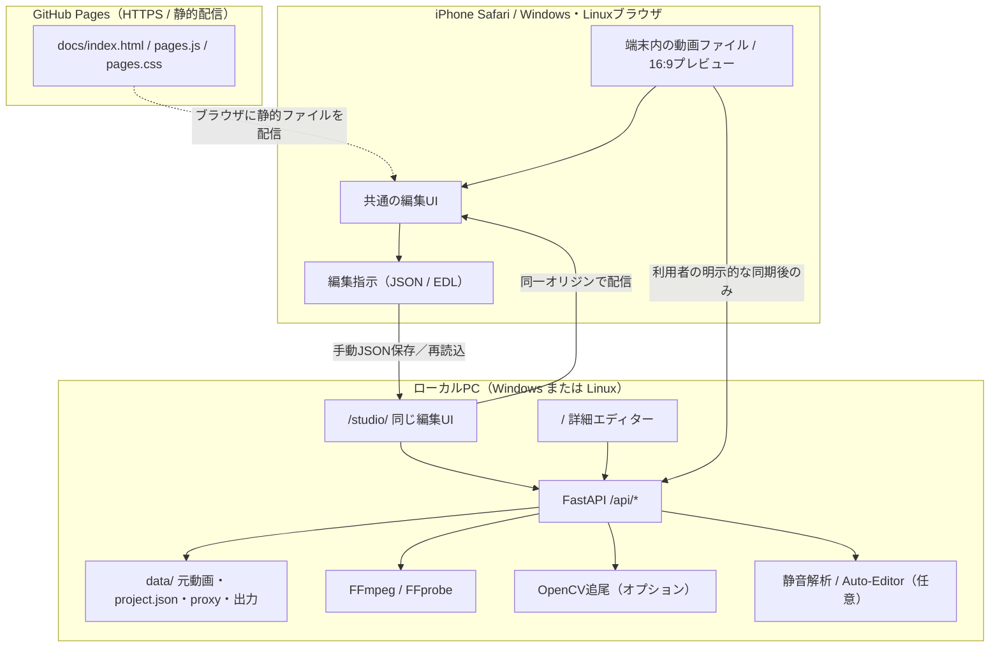
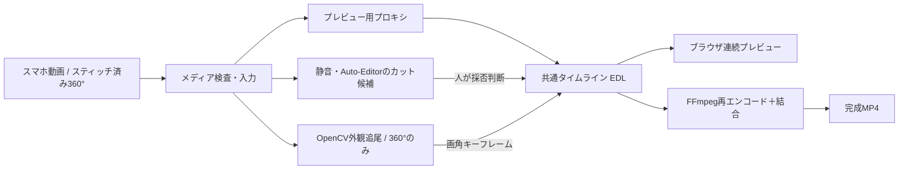
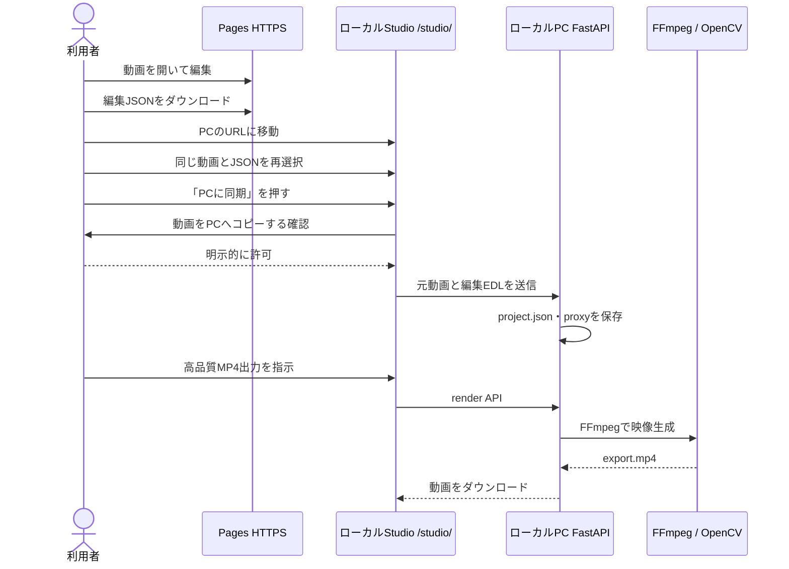

# Movie Modify — 統合仕様書

> **正式な仕様の参照先（Single Source of Truth）**  
> 文書 ID: MM-SPEC-001 ／ 版: **1.1** ／ 更新日: **2026-10-18**  
> 対象リポジトリ: [kameusagiyahoo/movie_modify](https://github.com/kameusagiyahoo/movie_modify)  
> 初回作成時の実装確認基準: `main@ba7160d8138e5985be2b89ea1873450320aec14e`  
> 本文の状態表示は、上記時点の**リポジトリに実際に存在するコード**を基準とする。将来の構想や未検証事項は区別して記載する。

**この文書に集約するもの：** 目的・要求・機能一覧・ユーザー操作・UI/UX・アーキテクチャ・編集JSON・API・Windows/Linux/iPhone/Pages運用・プライバシー・テスト・ロードマップ。日常の開発では**本書を正本**とし、README・個別運用手順は補助資料とする。

---

## 目次

1. [目的と設計原則](#1-目的と設計原則)
2. [提供モードと対応範囲](#2-提供モードと対応範囲)
3. [システム全体アーキテクチャ](#3-システム全体アーキテクチャ)
4. [機能要求・実装ステータス](#4-機能要求実装ステータス)
5. [UI/UX仕様：iPhone・PC](#5-uiux仕様iphonepc)
6. [ユーザー操作フロー](#6-ユーザー操作フロー)
7. [共通編集データ：EDL・画角キーフレーム](#7-共通編集データedl画角キーフレーム)
8. [動画処理・追尾・書き出し](#8-動画処理追尾書き出し)
9. [ローカルAPI仕様](#9-ローカルapi仕様)
10. [実行環境・インストール・運用](#10-実行環境インストール運用)
11. [安全性・プライバシー・データ保全](#11-安全性プライバシーデータ保全)
12. [品質・テスト・制約](#12-品質テスト制約)
13. [未実装事項と優先ロードマップ](#13-未実装事項と優先ロードマップ)
14. [実装ファイル・関連資料・文書管理](#14-実装ファイル関連資料文書管理)

## 1. 目的と設計原則

### 1.1 製品目的

長時間の**家族動画**を、不要な場面を取り除きながら大切な瞬間を失わずに編集する。通常のスマホ動画と、メーカー製ソフトウェアでスティッチ済みの360度動画の双方を扱う。

- **人が最終判断する非破壊編集**：解析結果は提案であり、自動削除を確定しない。オリジナル動画は変更しない。
- **1本のタイムラインに複数の撮影意図を載せる**：360度映像を、人物追尾→景色→人物追尾のように切り替える。
- **iPhoneとPCのどちらでも操作**：操作UIを画面幅に適合させ、編集データの構造は共通にする。
- **必要な計算だけPCに任せる**：Pages単独のブラウザ編集と、Windows/LinuxのFFmpeg・OpenCV処理を分離する。
- **プライバシーを優先**：編集のためにクラウドAIや外部動画サービスへ送信しない構成を基本とする。
- **交換可能な処理単位**：入力、提案解析、追尾、画角、出力、UIを分離し、将来の処理方式を追加しやすくする。

### 1.2 現在の対象／非対象

**対象**：1プロジェクトにつき元動画1本、時間指定の残す／カット、360度画角制御、追尾結果の確認、MP4またはブラウザ依存の試験出力。

**現時点では非対象**：複数素材を同じ時間軸に並べる本格的なマルチトラック編集、字幕自動生成、人物の本人識別、遮蔽後の確実な再識別、iPhone本体でPython/FFmpeg/OpenCVネイティブ実行、PagesとPCの自動バックグラウンド同期。

## 2. 提供モードと対応範囲

アプリは**3つのアクセス形態**を持つ。ローカルのStudioと詳細エディターは同じPC上のAPIとプロジェクト保存領域を共有する。

| モード | アクセス先 | 起動条件 | 主な操作 | 重い処理 |
|---|---|---|---|---|
| A. **GitHub Pages 単独** | [公開Webアプリ](https://kameusagiyahoo.github.io/movie_modify/) | インターネット／対応ブラウザ | 動画読込、カット・画角編集、WebGLプレビュー、JSON保存 | **使わない**。ブラウザ内の試験出力のみ |
| B. **ローカルStudio** | `http://127.0.0.1:8000/studio/` | Windows/Linux上でサーバー起動 | Aと同じUI、元動画のPC同期、FFmpeg出力、詳細画面への移動 | ローカルPC |
| C. **ローカル詳細エディター** | `http://127.0.0.1:8000/` | 同上 | 360度人物追尾、静音・Auto-Editor解析、全景タップ、詳細編集、出力 | ローカルPC |

iPhoneがPCの処理を使う場合は、PCを `--lan` で起動して `http://<PCのLAN IP>:8000/studio/` などに接続する。同一LANが基本であり、外出先からのアクセスは別途安全なVPN等が必要。

**区別すべき点**：

- Pagesの元動画は、ブラウザで `File` / `blob:` として開く。**編集開始だけではPCにもクラウドにもアップロードしない**。
- Pagesからローカルに移るときは、**編集JSONを保存 → ローカルStudioに移動 → 動画とJSONを再選択**する。ページ移動だけで元動画データは引き継がれない。
- Studioで利用者が「同期」を押し確認した場合は、**iPhoneとPC間で元動画がローカルPCへ転送される**。GitHub Pagesを経由する転送ではない。
- 完全自動のPages→PC接続、ファイルを選び直さずに移動する機能は**未実装**。

## 3. システム全体アーキテクチャ

### 3.1 実行環境とデータ境界



**注意：** 図のJSON引継ぎ矢印はファイル保存／読込の操作であり、Pages HTTPSからプライベートHTTP APIを直接呼ぶネットワーク通信ではない。ブラウザの混在コンテンツ／プライベートネットワーク制限を回避するため、ローカル版も `/studio/` に同じUIを配信する。

### 3.2 編集処理と依存関係



### 3.3 モジュール境界

| 層 | ファイル | 責務 |
|---|---|---|
| 編集データ／幾何 | [`movie_modify/core.py`](../movie_modify/core.py) | 区間の検証、分割、カット提案適用、yaw補間 |
| メディア処理 | [`movie_modify/media.py`](../movie_modify/media.py) | FFprobe、プロキシ、静音検出、Auto-Editor、FFmpegレンダー |
| 追尾 | [`movie_modify/tracking.py`](../movie_modify/tracking.py) | 360度パノラマのOpenCV外観追尾、キーフレーム生成 |
| サーバー | [`movie_modify/server.py`](../movie_modify/server.py) | プロジェクト・API・アップロード・ジョブ・認証 |
| 共通CLI | [`movie_modify/__main__.py`](../movie_modify/__main__.py) | Windows/Linux起動、LAN制限、データディレクトリ |
| 詳細UI | [`web/index.html`](../web/index.html)、[`responsive_ui.js`](../web/responsive_ui.js) | 追尾・解析・レンダリング操作 |
| 共通Studio/Pages UI | [`docs/index.html`](index.html)、[`pages.js`](pages.js) | ブラウザ編集、JSON、試験出力 |
| 編集履歴・下書き | [`docs/edit_history.js`](edit_history.js) | Pages／Studio／詳細UI共通。Undo/Redo・localStorage下書き・競合確認 |
| ブラウザ画角描画 | [`docs/live_preview.js`](live_preview.js)、[`web/live_preview.js`](../web/live_preview.js) | WebGLによる正距円筒図法→16:9 |
| PC接続補助 | [`docs/bridge_client.js`](bridge_client.js) | JSON引継ぎ、Studio同一オリジン同期、PC出力 |
| 開発文章支援 | [`.agents/skills/yomiyasu/`](../.agents/skills/yomiyasu/SKILL.md) | 日本語文書推敲のAgent Skill。動画実行には**関与しない** |

## 4. 機能要求・実装ステータス

表記：**実装**＝対象コードが存在、**任意**＝別途パッケージ導入が必要、**試験**＝利用環境に依存、**未実装**＝ロードマップ。自動テスト通過は個人PC・iPhone実機での操作保証を意味しない。

| ID | 機能・要求 | Pages | Studio / PC詳細 | 状態・備考 |
|---|---|---|---|---|
| F-01 | 通常動画の読込・プレビュー | ○ | ○ | 実装。ブラウザのデコード能力に依存 |
| F-02 | 360度正距円筒図法の動画読込 | ○ | ○ | 実装。**メーカーによるスティッチ後**の動画 |
| F-03 | 非破壊の区間分割・残す／カット | ○ | ○ | 実装 |
| F-04 | タイムライン拡大・横スクロール | ○ | ○ | 実装（ズーム／タッチジェスチャ） |
| F-05 | 360度 yaw/pitch/FOV キーフレーム編集 | ○ | ○ | 実装 |
| F-06 | 同一タイムラインで人物追尾・景色区間を混在 | 読込・再生 | 追尾生成・編集 | EDL共通、モード切替実装 |
| F-07 | 動画を再生しながら画角を連続プレビュー | ○ | ○ | WebGL実装。FPSは端末に依存 |
| F-08 | 音声の静音区間をカット候補化 | × | 詳細UI ○ | FFmpeg。**候補のみ**、自動確定しない |
| F-09 | Auto-Editorでカット候補生成 | × | 詳細UI ○ | 任意パッケージが必要 |
| F-10 | 全景画像上の対象選択→自動追尾 | × | 詳細UI ○ | OpenCV contribが必要。人物ID識別ではない |
| F-11 | カット予定区間をプレビューで飛ばす | ○ | ○ | 実装 |
| F-12 | 編集JSONの保存・再読込 | ○ | ○ | Pages/StudioはJSON保存・読込、詳細UIはPC保存 |
| F-13 | PagesのJSONをローカルPCに引継ぎ | 手動 | Studio ○ | **画面移動＋元動画/JSON再選択** |
| F-14 | 元動画＋編集指示をPCに同期 | ×（自動同期なし） | Studio ○ | 利用者の確認後にローカルPCへ転送 |
| F-15 | 720p/1080p MP4のFFmpeg出力 | × | Studio/詳細 ○ | 実装。ローカルPCで処理 |
| F-16 | ブラウザ単体での動画書き出し | 試験 | Studioでも試験 | MediaRecorder対応時のみ。音声等は端末依存 |
| F-17 | iPhone片手操作／PCマウス・キーボード | ○ | ○ | レスポンシブ実装、実機UXは継続検証 |
| F-18 | Windows / Linux 共通ローカル版 | 該当なし | ○ | 両OS CIでテスト |
| F-19 | 複数動画を並べるマルチトラック | × | × | **未実装** |
| F-20 | 自動字幕・音声文字起こし・シーンVLM | × | × | **未実装** |
| F-21 | 追尾対象の本人再識別・遮蔽復帰保証 | × | × | **未実装** |
| F-22 | Pages↔PC間の自動・リアルタイム同期 | × | × | **未実装** |
| F-23 | 操作履歴・Undo/Redo | ○ | ○ | **実装**。最大40状態を当該ブラウザのメモリに保持。直近10件を画面から選択可能 |
| F-24 | 編集JSONの端末内自動下書き保存・復元 | ○ | ○ | **実装**。ブラウザlocalStorageに最新EDLのみ保持し、素材の一致確認後に利用者が復元を選択。元動画は保持しない |
| F-25 | ローカルPC上の編集を端末間で自動同期 | × | × | **未実装**。既存のPC保存ボタンとStudioの明示的な同期を使う |

## 5. UI/UX仕様：iPhone・PC

### 5.1 共通設計

編集の中核は常に**動画プレビュー＋時刻に連動するタイムライン**とする。タッチ・マウスの違いはレイアウトと操作ボタンの配置で吸収し、カット判断・追尾・画角の編集データ形式は変えない。

- 追尾区間：**青**、景色／手動：**緑**、カット：**赤系**。色だけに依存せず名称・状態表示も併用。
- カットはトグルで取り消し可能。候補の自動解析だけで元ファイルは変更しない。
- キーフレームで時刻ごとの yaw/pitch/FOV を保持し、プレビューと書き出しに反映する。
- 長尺動画ではタイムラインのズームとスクロールにより細かい位置指定を可能にする。
- レイアウトは画面幅に追従し、プロジェクトは同一PC上に保存する。端末ごとに別のサーバー状態を持たない。

### 5.2 iPhone／狭い画面

```text
┌──────────────────────────┐
│  動画プレビュー（上部）  │
│  再生・シーク・時刻      │
├──────────────────────────┤
│ [タイムライン][画角][出力]│  ← Pages/Studio
│  拡大± ・ 左右スワイプ   │
│  選択区間・設定パネル    │
├──────────────────────────┤
│ 分割 │カット│景色│JSON保存│  ← 下部クイック操作
└──────────────────────────┘
```

- Pages/Studio：タブは**タイムライン／画角／保存・出力**。詳細UIでは**タイムライン／自動カット／書き出す**。
- 動画を上部に表示し、重要操作を下部タップ領域へ寄せる。2本指の拡大・縮小、横スワイプに対応。
- **「素材・JSON」**または**「素材・履歴」**は必要時に開く。
- PCへの同期には、元動画が端末からPCにコピーされることを明示して確認する。

### 5.3 PC／広い画面

```text
┌───────────┬─────────────────────────┬─────────────────┐
│素材・履歴 │  大きな動画プレビュー    │ 画角・解析・出力 │
│プロジェクト├─────────────────────────┤                 │
│           │ タイムライン・分割・編集│  詳細設定        │
└───────────┴─────────────────────────┴─────────────────┘
```

- 大きなプレビュー、タイムライン、詳細ツールを同時に参照できる。
- PCの詳細エディターでは **Space：再生／停止、S：分割、←／→：5秒移動**（入力欄での操作中を除く）。
- UIはマウス・トラックパッド・キーボードの操作を前提にするが、モデルと編集内容はiPhone操作と同一。

### 5.4 画面遷移と操作上の留意点

- Pagesのトップ画面には動画読込、タイムライン、画角、JSON出力、PC接続案内がある。
- Studioの画面はPagesとほぼ同じで、**PC同期・FFmpeg出力・詳細エディター移動・PC側変更の取得**が追加される。
- 詳細エディターは静音／Auto-Editor提案、全景タップ追尾、画角キーフレームとジョブ状況を扱う。
- **Undo/Redo・操作履歴・自動保存下書き（R-02）を実装**。ブラウザ内の編集変更は端末内に記録され、元動画を再選択した際に復元確認する。ブラウザの履歴は最大40状態、表示は直近10件。**元動画自体は保存されない**。PCサーバーへの明示的な保存・Studio同期は引き続き必要。
- **複数タブ／複数端末の同時編集を保証しない**。PC側変更を検知できる範囲では警告するが、完全な競合解決ではない。

## 6. ユーザー操作フロー

### 6.1 PC不要：Pagesの軽量編集

1. [Pages](https://kameusagiyahoo.github.io/movie_modify/)を開く。
2. 端末に保存したMP4/MOV等を選択し、通常／360度を指定。
3. 動画を再生して、分割→残す／カットを判断。
4. 360度動画の場合は景色の方向を指定し、必要な時刻にキーフレームを追加。
5. JSONを端末に保存。動画はJSONに含まれず、次回再開時は元動画も再選択。
6. 対応ブラウザでのみ試験的なMediaRecorder出力を選べる。

### 6.2 Pages編集をWindows／Linuxで仕上げる



**同期の意味：** Pagesサーバーに元動画をアップロードするのではなく、開いているiPhone/PCから**利用者のローカルPCのサーバーへファイルを転送する**。HTTP利用時はLAN内通信が暗号化されないため、ネットワークの信頼性を確認すること。

### 6.3 360度の人物追尾→景色への切替

1. ローカル詳細エディターで360度MP4を読み込む。
2. 追尾したい時間区間を選択する。**20分以下に分割**する。
3. 全景画像を開き対象人物をタップし、追尾処理を実行。
4. 計算された yaw/pitch/FOV キーフレームを区間に保存する。
5. 景色へ移る時刻で区間を分割し、**景色モード**へ変更して方向を指定する。
6. 再生して人物追尾→景色の切替を連続プレビュー。問題のある区間を修正。
7. カット候補の採否を確認し、720p/1080p MP4を書き出す。

追尾対象の入れ替わりや一時的な遮蔽は**自動的に解決する保証がない**。家族動画の大切な瞬間が切れないよう出力前に人が点検する。

## 7. 共通編集データ：EDL・画角キーフレーム

### 7.1 原則

- 編集時刻はすべて**元動画の先頭からの秒数**。カット後の出力タイムラインに対する秒数ではない。
- `segments` は開始順に並び、**区間は重ならない**。連続していない隙間は、出力に含めない暗黙のカットとなる。
- `keep=false` は出力から除外するフラグであり、元動画の削除ではない。
- `mode=manual` は景色／手動指定、`mode=follow` は追尾由来のキーフレーム区間。
- `keyframes` があれば、再生時に隣接キー間を補間する。yawは360度境界を跨ぐとき**最短回転方向**で補間。
- PagesのJSONには `schema`、`name`、`projection`、`duration` が付く。PCサーバーの `project.json` はID・素材メタ情報等も保持する。**共通互換単位は `segments` 配列**。

### 7.2 JSONの代表例

以下は30秒の360度動画を「人物追尾10秒→景色10秒→最後の10秒カット」に設定した例。

```json
{
  "schema": "movie-modify-pages/v1",
  "name": "family_360.mp4",
  "projection": "equirect",
  "duration": 30,
  "segments": [
    {
      "start": 0, "end": 10, "keep": true, "mode": "follow",
      "yaw": 0, "pitch": 0, "fov": 90,
      "keyframes": [
        {"time": 0, "yaw": 0, "pitch": 0, "fov": 90},
        {"time": 10, "yaw": 70, "pitch": -2, "fov": 80}
      ]
    },
    {
      "start": 10, "end": 20, "keep": true, "mode": "manual",
      "yaw": 140, "pitch": 0, "fov": 100, "keyframes": []
    },
    {
      "start": 20, "end": 30, "keep": false, "mode": "manual",
      "yaw": 140, "pitch": 0, "fov": 100, "keyframes": []
    }
  ]
}
```

### 7.3 制約・検証規則（バックエンド）

| フィールド | 型 | ルール |
|---|---|---|
| `start`, `end` | 数値 | 秒。非負、動画時間内、区間の長さは**0.04秒以上** |
| `keep` | 真偽値 | `true`＝残す、`false`＝出力しない |
| `mode` | 文字列 | `manual` または `follow` |
| `yaw` | 数値（度） | -180～180 |
| `pitch` | 数値（度） | -90～90 |
| `fov` | 数値（度） | 35～140 |
| `keyframes` | 配列 | キーは `time,yaw,pitch,fov`。厳密な時間昇順・区間内、最大18,000件/区間 |
| `segments` | 配列 | 最低1区間、最大5,000区間、重複なし |
| `tracking_warning` | 文字列 | 追尾の不安定性など（最大250文字に切詰め） |
| `suggested` | 真偽値 | 自動カット候補から派生したかどうか |

Pages側とPC側の検証条件には細かな許容差やキー数の違いがある。最大キー数など**サーバーの検証結果が最終的な保存可否**を決める。互換性が壊れないよう将来は明示的なスキーマバージョン検査の統合が必要。

### 7.4 データ保存先

- Pages：編集中のEDLをブラウザのメモリとlocalStorageに保存。最新の下書きのみを永続化し、Undo/Redo操作履歴（最大40状態）はタブを閉じると消える。明示的にJSONをダウンロード可能。**元動画は保存されず、再開時に選び直す**。
- PC：既定で `data/<project_id>/project.json`、`original.<ext>`、`proxy.mp4` または `proxy360.mp4`、`export.mp4`。
- `--data-dir` または `MOVIE_MODIFY_DATA` により保存ディレクトリを変更できる。
- 自動保存下書きのキーには、Pages/Studioでは**ファイル名・サイズ・更新日時・長さ・解像度・撮影形式**、詳細エディターでは**PCプロジェクトID・動画メタデータ**を用いる。編集途中のEDLのみ端末ごとのlocalStorageに保存し、PC上の編集との違いはベースライン検証で検知する。これらは**暗号学的な素材同一性検証ではない**。
- 接続時の補助識別子は一部セッションストレージに保存するが、**動画本体の永続化や完全な同時編集制御をするものではない**。

### 7.5 編集履歴・自動保存・復元（R-02）

- **履歴**：分割、カット切替、景色モード切替、キーフレーム操作、JSON読込、ローカル詳細UIの人物追尾・自動カットなどをスナップショットで保持する。Undo/Redoと履歴画面の直接選択で操作を取り消せる。スライダーの連続入力は短時間の操作をまとめる。
- **保存先**：同一ブラウザ・同一オリジンのlocalStorageへ、編集区間と選択位置・再生時刻の**最新下書きのみ**保存する。元動画ファイル・プレビュー・録画データは保存しない。最大40件のUndo/Redoスナップショットは**タブ内メモリ**に保持し、タブを閉じると失われる。
- **復元**：利用者が同じ元動画を再選択、またはPC上の同じプロジェクトを開くと、保存済み下書きを検知して復元するか尋ねる。元動画そのものは自動復元できない。
- **同一性**：Pages/Studioではファイル名・バイト長・最終更新時刻・再生時間・動画解像度・撮影形式を照合し、ローカル詳細UIはプロジェクトIDとサーバーの編集基準（ベースライン）が一致するか確認する。**ファイル内容のハッシュによる完全一致検証ではない**。
- **競合**：PC側の編集基準が変わった場合、ブラウザ下書きは**自動的に適用しない**。ローカル詳細UIでは以前の下書きをJSONとして取り出す導線を用意する。保存時の完全な同時更新排他はR-03の未実装領域。
- **失敗時**：localStorageが無効または容量不足の場合、端末内の自動保存に失敗したことを画面で通知し、手動JSON保存を案内する。端末の閲覧データ削除・シークレットモードで下書きが消える可能性があるため、長時間編集の節目ではJSON書き出しも行う。
- **PC同期との違い**：詳細UIの自動保存は**閲覧中の端末ブラウザへの下書き**であり、サーバーの\`project.json\`を書き換えるものではない。PCに確定保存するには「編集内容を保存」、StudioからPCに反映するには明示的な「同期」が必要。

## 8. 動画処理・追尾・書き出し

### 8.1 読込

- PCサーバー側では `ffprobe` で幅、高さ、動画秒数、コーデック、音声有無を調べる。
- 対象の拡張子：`.mp4`、`.mov`、`.m4v`、`.mkv`、`.webm`（ただし最終的なデコード可否は実際のコーデックに依存）。
- サーバーへの1ファイルの受信上限はコード上**50 GiB**、動画時間は**48時間以下**。
- 360度は横縦比が少なくとも概ね2:1の正距円筒入力を要求する。アスペクト比だけではスティッチ済みかは検証できない。
- `.insv`、`.360` 等のメーカー専用形式は**メーカー純正ソフトで正距円筒MP4等に変換する前処理が必要**。

### 8.2 プロキシとプレビュー

| 入力 | PCで生成するプレビュー | 閲覧方法 |
|---|---|---|
| 通常動画 | H.264/AAC 約960×540 | ブラウザ標準Video |
| 360度 | H.264/AAC **1280×640・24fps**、正距円筒を維持 | ブラウザWebGLで16:9へ投影 |
| 360度の静止画 | 必要時にFFmpegでJPEGを生成 | 指定yaw/pitch/FOVを確認 |

プレビューは軽量処理のため、完成動画の画角・鮮明さ・音声つなぎ目と完全一致する保証はない。新規360度のプロキシ変換は初回1回が基本。古いプロジェクトで360度用プロキシが無いときは必要に応じて作る。

### 8.3 自動カット候補

- **静音解析**：FFmpeg `silencedetect`（既定：-36 dB、最短3秒）。静かな場面が必ず不要とは限らない。
- **Auto-Editor**：任意導入。v1タイムラインをパースして削除候補を出す。
- 候補を人が選択して適用する。元の `segments` を分割し `keep=false` を設定するだけで元ファイルを変更しない。

### 8.4 360度人物追尾

- 全景静止画上の位置と追尾枠サイズを指定して処理する。
- オプション `opencv-contrib-python-headless`（必要に応じてNumPy）を用いた**外観追尾**。CSRTとテンプレート類似度を利用する。
- 追尾区間の許容長は**0.25～1,200秒（20分）**。より長い動画は区間を分割する。
- 推定結果を秒単位のyaw/pitch/FOVキーに変換する。画角計算結果を `follow` 区間に紐付ける。
- 顔認識や特定人物の確実な識別は実装していない。遮蔽・似た服装・照明変化・パノラマのつなぎ目では誤追尾する場合がある。

### 8.5 出力

- PC側は `ffmpeg` で **720p（1280×720）**／**1080p（1920×1080）**を生成。追尾キーが複数ある区間には `v360`／`sendcmd` を使って動く画角を適用。
- 出力時は残す区間を処理した後に結合する。音声がある素材では再エンコードして出力する。
- 結合・フィルタの相対パス化によりWindowsドライブ文字、スペース、クォートを含むフォルダへの互換性対応済み。
- CPU負荷が高く、8K／長尺では処理時間・ストレージが増える。重いジョブは**1プロセス1ワーカー**で直列に処理する。
- Pages単独の試験出力は `MediaRecorder` による再生等倍の録画。形式・音声取得・再生安定性・iPhone Safariの対応は保証できず、**PCのFFmpeg出力とは同等ではない**。

## 9. ローカルAPI仕様

サーバー：[`movie_modify/server.py`](../movie_modify/server.py)（FastAPI）。`/api/*` は `MOVIE_MODIFY_TOKEN` 設定時に認証対象となる。ただし `/api/health` と `/api/login` はログイン前の疎通用。

| メソッド | パス | 主な機能 |
|---|---|---|
| GET | `/` | 詳細エディター |
| GET | `/studio/` | Pagesと同じ共通UIをPCから配信 |
| GET | `/studio/pages.js` 等 | 同一オリジンのWebアセット |
| POST | `/api/login` | アクセストークン認証・Cookie |
| GET | `/api/health` | FFmpeg/FFprobe/Auto-Editor/OpenCVの利用可否 |
| GET | `/api/projects` | 保存済みプロジェクト一覧 |
| POST | `/api/projects` | 動画を登録、プロキシ生成ジョブ開始（multipart） |
| GET | `/api/projects/{id}` | プロジェクト詳細／EDL |
| PUT | `/api/projects/{id}/edits` | `segments` の検証・保存 |
| GET | `/api/projects/{id}/preview` | 動画プレビュー |
| POST | `/api/projects/{id}/prepare-preview360` | 360度プロキシ準備（必要時） |
| GET | `/api/projects/{id}/preview360` | 正距円筒プロキシMP4 |
| GET | `/api/projects/{id}/frame` | 指定yaw/pitch/FOVの静止画 |
| GET | `/api/projects/{id}/panorama` | 360度の全景静止画 |
| POST | `/api/projects/{id}/track` | 対象位置からOpenCV追尾ジョブ |
| POST | `/api/projects/{id}/analyze` | 静音/Auto-Editor解析ジョブ |
| POST | `/api/projects/{id}/apply-suggestions` | 選択したカット候補を適用 |
| POST | `/api/projects/{id}/render` | FFmpegで最終動画を書き出すジョブ |
| GET | `/api/projects/{id}/export` | 書き出したMP4を取得 |
| GET | `/api/jobs/{job_id}` | queued/running/done/failed と進捗 |

データの例：

- `POST /api/projects` は `file` と `projection=flat|equirect` を受け取る。
- `PUT .../edits` は `{"segments":[...]}` を受け取る。
- `POST .../track` は `segment_index`, `x`, `y`, `box` を受け取る。
- `POST .../analyze` は `method=silence|auto_editor`、`noise_db`、`min_seconds` を受け取る。
- `POST .../render` は `size=720p|1080p` を受け取る。
- 重い処理はジョブIDを返し、`GET /api/jobs/{job_id}` で状態を問い合わせる。ジョブキュー状態はサーバープロセスのメモリ内であり永続化されない。

## 10. 実行環境・インストール・運用

### 10.1 共通前提

- Windows 10/11（64-bit）またはLinux（Ubuntuなど）。
- 推奨：Python 3.11以降。FFmpegとFFprobeがPATH上にあること。
- `requirements.txt`：FastAPI、Uvicorn、python-multipart。
- `requirements-tracking.txt`：OpenCV contrib・NumPy（任意）。
- `requirements-optional.txt`：Auto-Editor（任意）。
- 大きな動画に十分な空きディスク、RAM、CPU。32GB以上などの条件は目安であり機能要件の保証値ではない。

### 10.2 初回起動

Windows（事前にPythonとFFmpegを導入）：

```powershell
winget install --id Gyan.FFmpeg -e
# ターミナルを開き直す
.\scripts\start-windows.cmd
```

Ubuntu：

```bash
sudo apt update
sudo apt install -y ffmpeg python3-venv
bash scripts/start-linux.sh
```

共通のPython CLI：`python -m movie_modify --port 8000`。データ保存先変更：`--data-dir`。既定は `127.0.0.1:8000` のみで外部端末には公開しない。

iPhone連携（Windows PowerShellの例）：

```powershell
$env:MOVIE_MODIFY_TOKEN="十分に長いランダムなパスフレーズ"
.\scripts\start-windows.cmd --lan
```

Linux：

```bash
export MOVIE_MODIFY_TOKEN="十分に長いランダムなパスフレーズ"
bash scripts/start-linux.sh --lan
```

iPhoneのSafariから `http://<PCのLAN IP>:8000/studio/`。接続とWindowsファイアウォールの設定は[Windows/Linux運用](windows-linux.md)を参照。

## 11. 安全性・プライバシー・データ保全

### 11.1 データフロー別の注意

| 場面 | 振る舞い／注意 |
|---|---|
| Pagesでの編集 | ソース動画はブラウザ内で扱う。公開GitHubリポジトリに個人動画をコミットしない |
| Pages→PC画面移動 | JSONを手動保存・再読込。Pages HTTPSからLAN HTTP APIへ自動リクエストしない |
| Studio同期 | 確認後に**iPhone等からPCへ元動画を転送**する。大容量・従量通信に注意 |
| LANでの認証 | `MOVIE_MODIFY_TOKEN` のCookie。標準HTTPは暗号化されない |
| FFmpeg/追尾 | 原則PC内で処理。外部AIサービスは必須でない |
| 保存ファイル | 元動画・編集データ・プロキシ・完成動画がPCストレージを消費する |
| 将来のAI追加 | 外部API利用は別途明示的な設定・同意・データ最小化を設計する |

### 11.2 現在のセキュリティ制約

- FastAPI自体にはTLS/HTTPS機能を設定していない。**認証CookieがあってもHTTPの内容は平文**。
- `--lan` 使用時は長いトークンを必要とするが、信頼できないネットワークやインターネットへのポート開放は避ける。
- 詳細エディターとStudioの静的画面はAPI認証と同じアクセス制御ではない。私的動画を扱う場合はネットワーク境界自体も保護する。
- 認証・セッション・CSRF対策・HTTPS終端・バックアップ・衝突解決・監査ログは商用公開サーバー相当には未整備。インターネットに直接公開しない。
- OpenCV追尾は**人物IDの照合ではなく外観推定**。プライバシーと精度上の限界をUIで示す。

## 12. 品質・テスト・制約

### 12.1 自動テスト

リポジトリの [`.github/workflows/tests.yml`](../.github/workflows/tests.yml) で、**Ubuntu/LinuxランナーとWindowsランナー**のPythonテスト、FFmpeg結合／追尾キーフレーム生成の回帰テスト、静的アセット配信、Pages/Studioブリッジのテスト、JavaScript構文チェックを行う。

初回仕様統合前の確認基準：2026-10-17、[`main@ba7160d` のWindows・Linuxテスト成功](https://github.com/kameusagiyahoo/movie_modify/actions/runs/39025902718)、[同コミットのPagesデプロイ成功](https://github.com/kameusagiyahoo/movie_modify/actions/runs/39025902455)。

### 12.2 未検証・既知の制約

1. **iPhone Safari実機**での長尺動画・WebGL再生・MediaRecorder書き出し・プレビュー操作は、CIだけでは保証できない。自動保存はブラウザ容量上限、プライベートモード、閲覧データ消去に左右されるため、**別途JSONを保存すること**。
2. 360度のブラウザプレビューは軽量投影であり、最終FFmpeg出力とわずかな見え方の差があり得る。
3. 追尾は遮蔽・人物交差・カメラブレ等で失敗し得る。区間ごとに人が確認する。
4. 1プロジェクト1素材が基本。複数素材の同期・切替編集は未実装。
5. ブラウザのメモリ内状態とPCの保存状態を完全には自動同期しない。JSONの保存・動画再選択が必要。
6. 同時編集で衝突を完全に防ぐロック／バージョン管理は未実装。
7. FFmpeg出力はCPU・ストレージ集約型。大容量ファイル転送にはLAN品質の影響が大きい。
8. 静音による候補は**家族動画にとって重要な無音シーンを誤判定し得る**ため、自動削除しない。

### 12.3 受け入れ基準（開発時に検証する項目）

| ID | 受け入れ条件 | 主な検証方法 |
|---|---|---|
| AC-01 | 通常動画をPages/PCで読めてタイムラインを分割できる | ブラウザ手動確認＋UIテスト |
| AC-02 | 360度の人物追尾と景色を同じEDLに保存できる | Python回帰テスト＋実動画確認 |
| AC-03 | 人物追尾・景色キーフレームが連続再生に反映される | WebGL実機確認 |
| AC-04 | 保留したカット区間を戻して残せる | EDL/Pagesテスト |
| AC-05 | PagesのJSONをStudioで読み、PCでMP4を書き出せる | Studio統合テスト |
| AC-06 | Windows／Linux双方でFFmpegパス・レンダリングが成功 | GitHub Actionsの両OSジョブ |
| AC-07 | iPhone操作時に主要ボタンが押しやすく、タイムラインを拡大できる | iPhone Safari実機テスト |
| AC-08 | LANでの動画同期が本人の明示操作なしに起きない | UIテスト・セキュリティレビュー |
| AC-09 | プロジェクト保存／再読み込みでEDLが消失しない | 再起動・復元テスト |
| AC-10 | 未対応環境では人物追尾／書出を利用不可と明示する | 非対応ブラウザ・依存未導入時の試験 |
| AC-11 | Undo/Redoで分割・カット・画角の編集状態が復元できる | ブラウザ履歴ユニットテストとUI確認 |
| AC-12 | ブラウザ再起動後、同じ素材に限り下書きの復元を確認できる | localStorageテスト・Safari実機確認 |
| AC-13 | PC側の状態が変化した場合、古い下書きで自動上書きしない | ベースライン競合テスト |

**注：** この表は回帰テストと実機QAの**目標定義**も兼ねる。全項目が既に実機合格しているという意味ではない。

## 13. 未実装事項と優先ロードマップ

優先順位は、家族動画の実用性・データ保全・iPhone/PC操作性を基準とした提案であり、実装済みとは区別する。

| 優先 | ID | 改善テーマ | 期待する成果 |
|---|---|---|---|
| P0 | R-01 | **iPhone実機QA／長尺ストレステスト** | 再生停止・メモリ不足・同期失敗・タッチ操作を検知 |
| 完了・継続改善 | R-02 | **保存・復元／Undo・Redo** | 端末内下書きとUndo/Redoを実装。iPhone実機での復元・容量耐性は継続検証 |
| P0 | R-03 | **Studio／詳細編集の競合解決** | 下書きの競合警告は実装。サーバー保存時の完全な楽観ロック／複数端末のマージは未実装 |
| P1 | R-04 | **転送UX改善（進捗・再開）** | iPhoneから大容量素材を安全に引き継ぐ |
| P1 | R-05 | **360度追尾の復帰精度・遮蔽処理** | 子どもを見失った場面を修正しやすくする |
| P1 | R-06 | **カット・画角切替の直接ドラッグ操作** | タイムライン操作の手数削減 |
| P1 | R-07 | **クラウドを使わない安全なHTTPSアクセス経路** | LANやVPNでの通信機密性 |
| P2 | R-08 | **複数動画／マルチトラック** | 旅行全体の映像編集 |
| P2 | R-09 | **音声認識・シーン推定等の交換可能な解析プラグイン** | 提案の品質向上と拡張性 |
| P2 | R-10 | **ジョブ永続化・バックアップ・再開可能レンダリング** | 長時間処理の堅牢化 |
| P2 | R-11 | **字幕・トランジション・音量調整** | より本格的な家庭用動画編集 |

## 14. 実装ファイル・関連資料・文書管理

### 14.1 正本と補助資料

- **この統合仕様書（正本）**：[`docs/SPECIFICATION.md`](SPECIFICATION.md)
- [README](../README.md)：導入・起動・公開リンク・最短の説明。仕様の詳細は本書を参照。
- [Pages ↔ ローカル連携手順](bridge-workflow.md)：操作・安全上の注意。
- [Windows／Linuxセットアップ](windows-linux.md)：具体的な環境構築手順。
- [Pages版 README](README.md)：ブラウザ版の入出力仕様。
- [yomiyasu](yomiyasu.md)：**開発文書を読みやすくするAgent Skill**。実行時の編集機能と混同しない。
- [GitHub Pages 実際のアプリ](https://kameusagiyahoo.github.io/movie_modify/)。

### 14.2 仕様変更時の運用ルール

1. 新しい機能を作るときは、実装前または同じPRで**対応する要求ID・UI・API・JSON・制約**を本書に追記する。
2. ステータスを「実装」に変える場合は**コード、再現手順、テスト**の3つを揃える。構想のみを実装済みと書かない。
3. READMEや個別ドキュメントと矛盾する場合は本書を確認し、**同じPRで古い記述を修正**する。
4. EDL形式・動画変換方式・認証境界の変更は互換性と移行手順も記録する。
5. iPhone/PCで同じアプリを操作する設計を保持する。端末別に編集ルールを複製しない。
6. 人物追尾精度や安全性について、CI通過を超えた保証表現をしない。
7. 文書推敲にyomiyasuを使う場合でも、機能名・数値・制限・否定の意味が変わっていないか開発者が確認する。

---

**仕様の責任境界**：現在実装されているのは軽量なブラウザ編集とローカルPC処理、手動のデータ引継ぎである。**実機評価・長尺動画の安定性・高い追尾精度・完全な端末間同期**は今後の改善課題として扱う。
